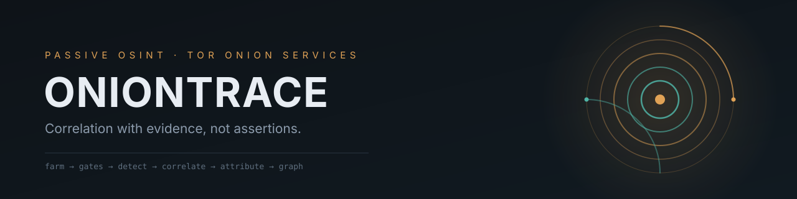
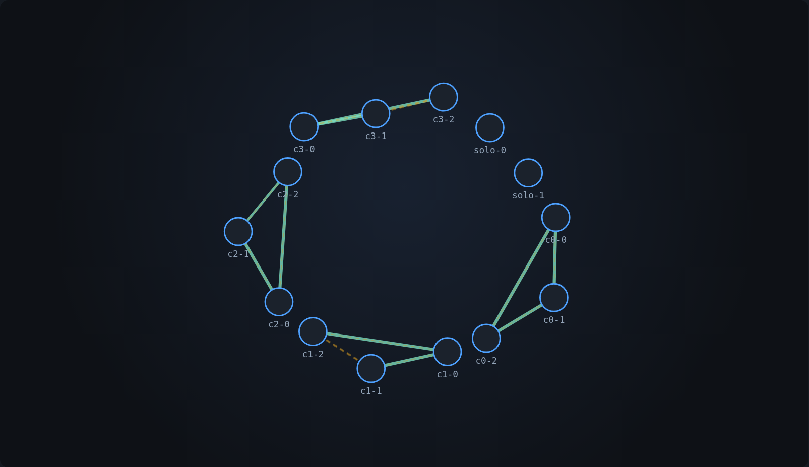
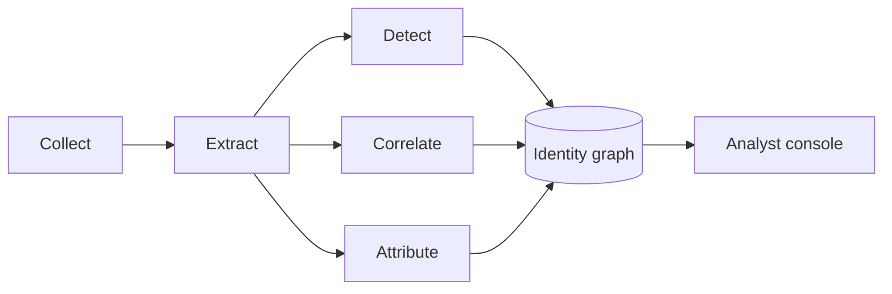

<div align="center">
  
  <br><br>
  <a href="requirements.txt"></a>
  <a href="tests"></a>
  <a href="LICENSE"></a>
  
</div>

ONIONTRACE turns public onion-service pages into evidence. It collects only what an
anonymous visitor can see, extracts identifiers and shared artefacts, detects
misconfigurations, proposes links between services, and presents the result in an analyst
console. Every proposed link carries a score and the check that produced it: the tool
supplies leads, not identity claims.

> **Authorised use only.** Collection is passive and never exploits a target. Nothing in
> this repository contacts a third party's onion service by default. Read
> [`ACCEPTABLE_USE.md`](ACCEPTABLE_USE.md) before running it against anything you do not own.

<p align="center">
  
  <br>
  <sub>The identity graph for a case: operator clusters, singleton controls, and one contested edge.</sub>
</p>

## How it works



| Stage | What it does |
|---|---|
| **Collect** | Front pages, directory walks, `Onion-Location` pairs, a public search index, certificate transparency and public Telegram previews — behind signed permits and budgets. |
| **Extract** | PGP fingerprints, BTC/XMR addresses, emails, analytics IDs, hosted resources and TLS certificate fields, each a typed artefact with provenance. |
| **Detect** | Deployment mistakes that make a service findable: version banners, default pages, exposed panels, missing headers. |
| **Correlate** | Links services on shared artefacts, with a frequency cap so a value used by half the network cannot merge unrelated operators. |
| **Attribute** | Stylometric retrieval over generated personas — reported as synthetic retrieval, not authorship of a real person. |
| **Graph** | A per-case identity graph with evidence, trust edges, analyst decisions and an append-only audit trail. |

## Quick start

```bash
git clone https://github.com/idkgarvit/oniontrace.git
cd oniontrace

# The analyst console in its own window (loopback only)
run/oniontrace-gui

# The whole pipeline in one command
python -m oniontrace run --seed 20260925 --case CASE-1
# writes out/CASE-1-20260925/manifest.json and casework/CASE-1/
```

The console is the main interface: `run/oniontrace-gui` starts a local service on a free
loopback port, opens it in a Chromium app window, and stops the service when the window
closes. `python -m dashboard` serves the same console for a headless machine.

## Commands

```bash
python -m farm validate                          # check the generated farm
python -m farm generate --seed 20260925 --out out
python -m farm summary --seed 20260925

python -m gates --root casework ack --accept --actor analyst --role case_owner
python -m collect targets --seed 20260925        # what a fixture run can serve
python -m collect --root casework run --case CASE-1 --actor analyst \
    --role case_owner --fixtures --search-query marketplace

python -m eval run --seed 20260925 --out out     # score every module against the farm
python -m eval report --results out/eval-results.json
```

## Requirements

- Python 3.10 or newer.
- No third-party packages for the core pipeline, farm, evaluation or gates.
- Optional extras in `requirements.txt` for live collection, certificate transparency, the
  console and the QA scripts.

```bash
python -m pip install -r requirements.txt   # optional
```

## Evaluation

There is no public ground truth for who operates which onion service, so correlation is
measured on a farm where the clusters are known by construction. On seed `20260925`:

| Correlator | Proposed | Precision | False-merge rate |
|---|---:|---:|---:|
| Naive shared-artefact | 58 | 0.207 | — |
| Frozen score threshold | 21 | 0.571 | 0.429 |
| Frequency cap | 12 | **1.000** | **0.000** |

The result repeats on 20 seeds and six farm topologies. The real-data checks are narrower:
3,018 certificates from certificate transparency, eight onion services the project published
itself, 112/112 responses, and no third-party onion service fetched. Full output:
`python -m eval run`.

## Layout

```
farm/        deterministic synthetic farm: services, flaws, personas, ground truth
collect/     passive collection paths, permits, budgets, WARC and checkpoints
eval/        metrics, splits, detectors and the evaluation harness
gates/       cases, authorisation, retention, audit, exports, acceptable use
graph/       identity graph, artefact resolution and trust edges
dashboard/   analyst console (FastAPI + Jinja)
scripts/     QA, verification and data-generation tooling
tests/       unit and integration tests
data/        frozen evidence used by the tests
assets/      banner and console screenshot
```

Generated output goes to `out/`; case data goes to `casework/`. Both are gitignored.

## Tests

```bash
python -m pytest -q
```

The suite covers the farm, collection fixtures, gates, graph, evaluation and the console.

## License

MIT. See [`LICENSE`](LICENSE).
